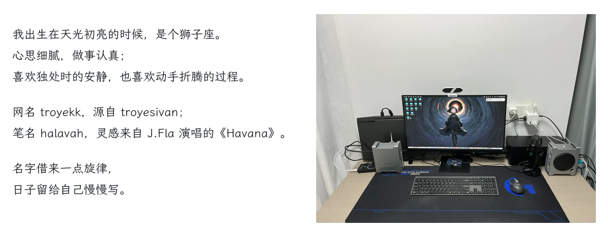
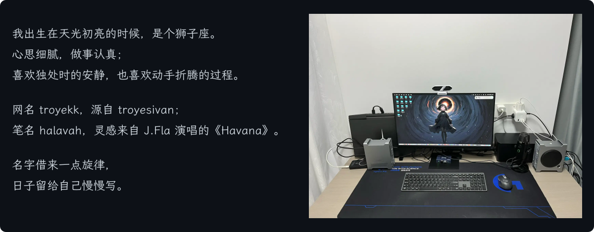

  

<a href="assets/profile/intro-desktop-light-wenkai.svg#gh-light-mode-only">
  <picture>
    <source media="(max-width: 700px)" srcset="assets/profile/intro-mobile-light-wenkai.svg">
    
  </picture>
</a>

<a href="assets/profile/intro-desktop-dark-wenkai.svg#gh-dark-mode-only">
  <picture>
    <source media="(max-width: 700px)" srcset="assets/profile/intro-mobile-dark-wenkai.svg">
    
  </picture>
</a>

## Libra · 开发工具

- **[Libra Spring Boot Starter Toolkit](https://github.com/halavah/libra-spring-boot-starter-toolkit)** — Java 8+ 工具集合，提供 SQL 数据访问、轻量 HTTP 与 Redis 集成。
- **[Libra Boot Vue](https://github.com/halavah/libra-boot-vue)** — 在浏览器加载 Vue 单文件组件，构建无需预打包的轻量页面。
- **[Libra Boot Low](https://github.com/halavah/libra-boot-low)** — 通过 YAML 与 Jinja2 模板生成 Spring Boot、Vue、SQL 和接口示例。

## Projects · 更多实践

- **[Kiro Travel](https://github.com/halavah/kiro-travel)** — 基于 Next.js 与 SQLite 的旅游服务平台，覆盖景点、门票与酒店等业务。
- **[Flare Plus](https://github.com/halavah/flare-plus)** — Cloudflare API 测试与学习项目，整理常用服务的示例与资料。

日常使用 TypeScript、React、Electron、Python，在 X 与博客分享实测和构建记录。

GitHub 贡献 · 2026

<picture>
  <source media="(prefers-color-scheme: dark)" srcset="assets/profile/github-contribution-grid-snake-dark.svg">
  
</picture>

